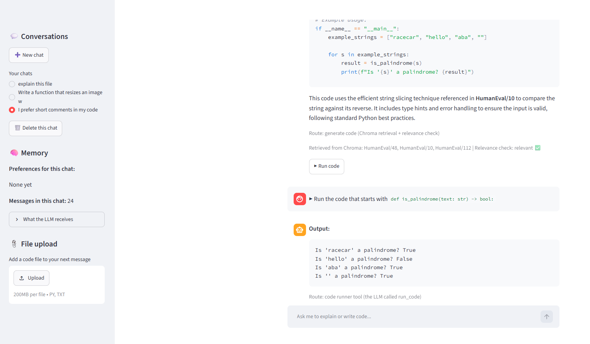
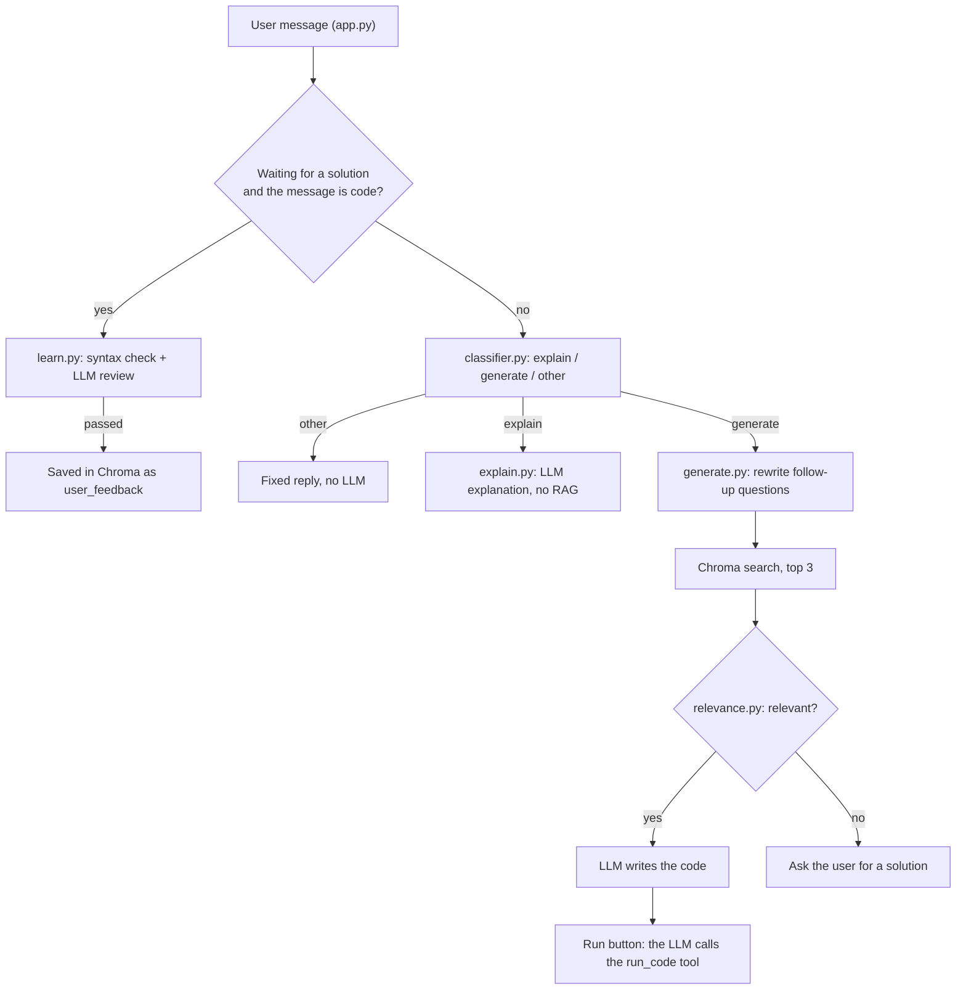

# AI Coding Assistant with CRAG

A chat assistant that explains code, writes code with the help of a knowledge base of solved Python problems (HumanEval), checks if what it retrieved is really useful (Corrective RAG), learns new solutions from the user, runs code with a tool that the LLM calls, and remembers each conversation.

Built for the Cellula Technologies NLP internship (Project 2, part 1).



## Features

- **RAG over HumanEval:** 164 solved Python problems are split with code chunking, embedded with `BAAI/bge-small-en-v1.5` and stored in Chroma.
- **Intent classifier and router:** every message is classified as `explain`, `generate` or `other`, and sent to the matching route.
- **Corrective RAG:** before writing code, an LLM checks if the retrieved problems really help. If not, the assistant does not guess: it asks the user for a correct solution.
- **Human feedback learning:** a solution sent by the user is checked (syntax with `ast`, then an LLM review) and only then added to Chroma, with metadata.
- **Code runner tool:** the LLM is bound to a `run_code` tool and answers with a tool call. The code runs in a separate process with a time limit.
- **Memory:** conversations, messages and per-chat preferences are saved in SQLite. The LLM receives the preferences and the last 6 messages, so follow-up questions work.
- **Streamlit interface:** streaming answers, several chats, a view of what the LLM receives, file upload and a Run button.

## How a message flows



Every answer and every run is saved in `memory.db`, and the memory is read again by the classifier, the relevance check and the LLM on the next message.

## Task parts and files

| Part | What it does | File |
|---|---|---|
| 1 | Explore the HumanEval dataset | `explore_data.py` |
| 2A | One Document per problem (prompt + solution), code chunking | `prepare_documents.py` |
| 2B | Embeddings and the Chroma vector database | `vector_db.py` |
| 3A | Gemini models through `ChatOpenAI`, with fallbacks | `llm.py`, `check_models.py` |
| 3B | Intent classifier, also picks up the user's preferences | `classifier.py` |
| 4A | Explanation route (no RAG) | `explain.py` |
| 4B | Router | `router.py` |
| 5A | Relevance check (the evaluator of CRAG) | `relevance.py` |
| 5B | Generation route: rewrite, retrieve, check, generate | `generate.py` |
| 6 | Human feedback learning | `learn.py` |
| 7 | Code runner tool and tool calling | `code_runner.py` |
| 8 | Conversation memory in SQLite | `memory.py` |
| 9 | Streamlit app | `app.py` |

## Project structure

```text
.
├── app.py                 # Streamlit chat interface
├── explore_data.py        # look at the HumanEval data
├── prepare_documents.py   # Documents + code chunking
├── vector_db.py           # embeddings + Chroma
├── llm.py                 # Gemini models with fallbacks
├── check_models.py        # helper: which Gemini models can answer right now
├── classifier.py          # explain / generate / other + preferences
├── explain.py             # explanation route
├── router.py              # sends each message to its route
├── relevance.py           # relevance check (CRAG)
├── generate.py            # generation route
├── learn.py               # checks and saves solutions from the user
├── code_runner.py         # run_code tool + tool calling
├── memory.py              # SQLite memory: chats, messages, preferences
├── data/
│   └── humaneval.parquet  # HumanEval, downloaded from Hugging Face
├── requirements.txt
└── .env                   # your API key (not in the repository)
```

`chroma_database/` and `memory.db` are created by the app when it runs.

## Setup

You need Python 3.10 or newer and a free Gemini API key from [Google AI Studio](https://aistudio.google.com/).

```bash
git clone https://github.com/<your-username>/<repository-name>.git
cd <repository-name>
python -m venv .venv
```

Activate the virtual environment:

```bash
# Windows (PowerShell)
.\.venv\Scripts\Activate.ps1
# macOS / Linux
source .venv/bin/activate
```

Install the packages and add your key:

```bash
pip install -r requirements.txt
```

Create a file named `.env` in the project folder:

```text
GEMINI_API_KEY=your_key_here
```

Run the app:

```bash
streamlit run app.py
```

The first run downloads the embedding model (about 130 MB) and builds `chroma_database/` from HumanEval, so it takes a few minutes. Later runs open the saved database.

## Things to try

| Message | What happens |
|---|---|
| `I prefer short comments in my code` | Route `other`. The preference appears in the sidebar. |
| `Write a Python function that checks if a string is a palindrome` | Route `generate`, sources from HumanEval, relevance check ✅, a Run button under the code. |
| `Now make it ignore spaces and capital letters` | A follow-up: the request is rewritten for the search, the code is changed. |
| `Which line removes the spaces?` | Route `explain`, the answer uses the memory. |
| `Write a function that resizes an image with Pillow and saves the result` | Relevance check ❌, the assistant asks for a solution. Send one in a python code block: it is checked, then saved. Ask again and the source is `user_feedback`. |
| Click **Run code** | The LLM calls `run_code`. The output (or the error) is saved as a message, so you can ask "why did it fail?". |

## Testing each part

Each file has a small test that runs with `python <file>.py`. The number of Gemini requests is given because the free tier has a small daily limit.

| Command | What it checks | Gemini requests |
|---|---|---|
| `python explore_data.py` | shape, columns, one full problem, text lengths | 0 |
| `python prepare_documents.py` | 164 Documents, 164 chunks, metadata | 0 |
| `python vector_db.py` | number of chunks, top 3 results for 3 questions | 0 |
| `python llm.py` | one answer and the model that gave it | 1 |
| `python check_models.py` | each model on its own (useful after a 429 or 503 error) | 3 |
| `python code_runner.py` | normal code, error, infinite loop, `input()`, long output, tool call | 1 |
| `python learn.py` | not code, syntax error, wrong solution, correct solution | 2 |
| `python router.py` | a short conversation through all the routes (in a new chat) | about 13 |

Note: `python learn.py` saves its correct solution in Chroma each time it runs.

## Design decisions

- **Code chunking:** the splitter cuts Python code between classes and functions first, so a function is not cut in half. With `chunk_size=2000`, every HumanEval problem (the longest has 1,993 characters) stays one chunk, with its description and its solution together.
- **Local embeddings:** `bge-small-en-v1.5` runs on the CPU, needs no API key and uses none of the Gemini quota.
- **An LLM as the relevance evaluator:** a distance score alone cannot tell "a similar problem with different words" from "a different problem with the same words". Any answer other than exactly `relevant` counts as not relevant, so code is never built on weak context.
- **Query rewriting:** a follow-up like "now write it in Java" is rewritten into a complete request before the search, using the conversation memory. The first message of a chat skips this step.
- **Two model chains:** `llm` starts with the strongest model for explanations and code; `fast_llm` starts with a light model for one-word decisions. Both use fallbacks, so a busy or exhausted model is replaced automatically.
- **Three checks before learning:** is it code, is the syntax valid, does an LLM review say it solves the request. The first two cost no request. A wrong solution in the knowledge base would mislead every later user, so anything unclear is rejected.
- **The code runner:** a separate process, an empty temporary folder, a 10 second limit, no keyboard input and at most 10,000 characters of output.
- **SQLite memory:** one file, part of Python, with transactions (a question is never saved without its answer) and per-chat preferences that the classifier replaces as a complete list.

## Limitations and future work

- **Free tier quota:** a `generate` message can use up to 4 Gemini requests (classifier, rewrite, relevance check, generation). A paid plan removes this limit.
- **The code runner is not a full sandbox:** the code can still read files or use the network. A real sandbox would run it in a Docker container or on a separate machine.
- **Tool calling is started by the Run button:** the next step is an agent loop where the LLM runs the code by itself, reads the error, fixes the code and runs it again.
- **One local user:** SQLite fits a single user on one computer. A shared deployment would use a server database such as PostgreSQL.
